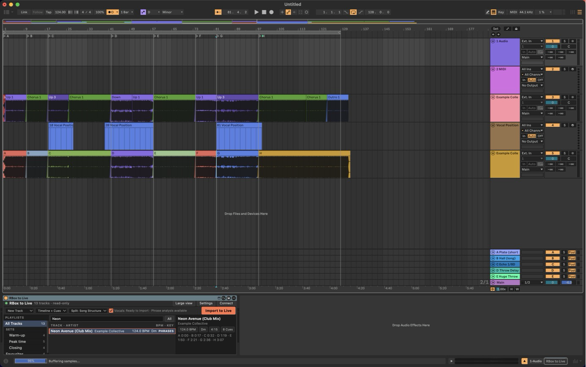
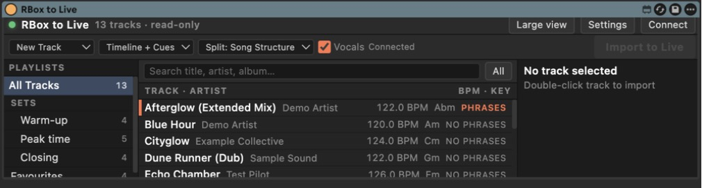
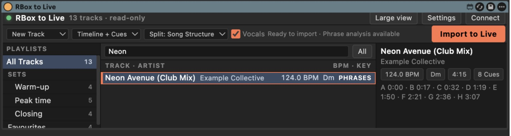
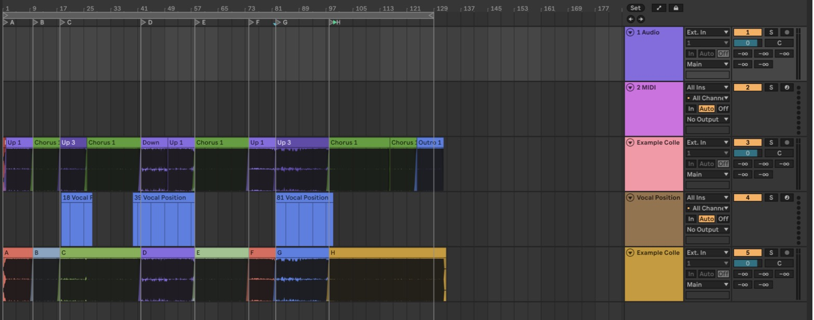
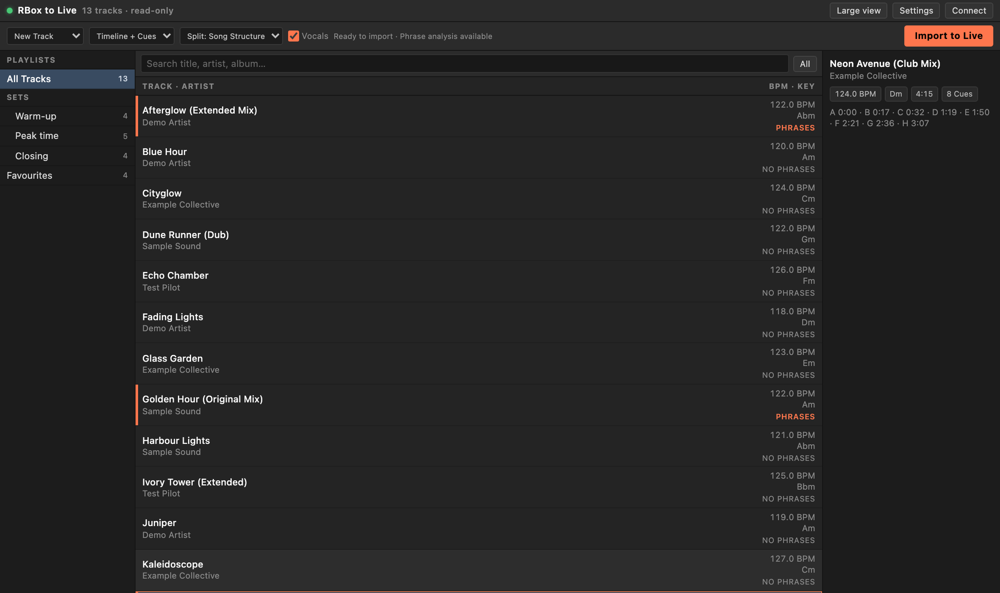
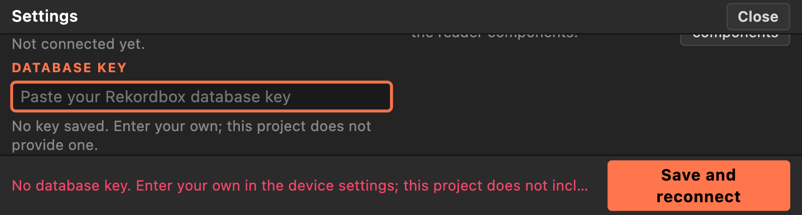

# RBox to Live

A Max for Live device that puts your Rekordbox library inside Ableton Live. Search your collection, pick a track, and import it with its song structure, hot cues, beat grid and vocal positions already laid out on the Arrangement.



The device only reads. Your Rekordbox library and your music files are never changed, and nothing is copied: Live's clips point at the audio files where they already are.

> **You need your own Rekordbox database key.** Rekordbox encrypts `master.db`. This project does **not** provide, include, generate, derive or download that key, and it cannot help you find one. You obtain it yourself, somewhere else, and enter it once in the device's **Settings** before the device can read anything. See [The database key](#the-database-key).

## What an import gives you

- **Phrase clips.** The track is cut at the phrase boundaries Rekordbox analysed (its "Song Structure"). Each clip is named and coloured by phrase, for example `Intro`, `Verse 2`, `Chorus`, `Bridge`, `Outro`. Tracks Rekordbox rated "High" mood use `Intro 1/2`, `Up 1/2/3`, `Down`, `Chorus 1/2` and `Outro 1/2`.
- **Hot cue clips.** Switch the split to **Hot Cues** and each clip is named by its cue letter (`A` to `H`) and coloured like the slot in Rekordbox.
- **Locators on the Arrangement.** One locator per hot cue, labelled with the cue letter, on the exact beat. Memory cues are not imported.
- **A Vocal Position track.** One clip for every region where Rekordbox hears vocals, named by its start bar (for example `18 Vocal Position`).
- **The Rekordbox beat grid.** Every beat of the grid becomes a warp marker, so each beat in the file sits on its beat in Live, including tracks that drift.
- **Tempo and key.** Live's tempo and key are set from the track.
- **Phrase badges in the list.** Tracks with phrase analysis show `PHRASES`; the rest show `NO PHRASES`, so you can tell before you import.







## Requirements

- macOS and Ableton Live 12 with Max for Live (Live Suite, or Live Standard with the Max for Live add-on). Developed and tested on Live 12.3.
- Rekordbox 6 or 7 on the same Mac (the library file is `master.db`). If your library is on an external drive, connect it first.
- Your own Rekordbox database key, entered in the device's Settings. It is not part of this project. See [The database key](#the-database-key).
- Python 3 that includes `venv`. Apple's command line tools provide one (`xcode-select --install`); Homebrew and python.org installs work too. The device uses it once, to build its own private environment.
- An internet connection the first time, to download one small Python package (the SQLCipher database driver).

## Install

1. Download `RBox-to-Live-<version>.zip` from the [Releases](../../releases) page and unzip it.
2. Double-click **Install RBox to Live.command**. It copies the device into your Ableton User Library (`~/Music/Ableton/User Library/Presets/Audio Effects/Max Audio Effect/RBox to Live`). macOS may ask you to confirm opening a downloaded script; right-click it and choose Open.
3. In Live, open the browser, go to **Audio Effects > Max Audio Effect > RBox to Live**, and drop **RBox to Live.amxd** on any track.
4. The first time, the device asks for its components. Open **Settings** in the device and press **Install components**. This creates a private Python environment under `~/Library/Application Support/RBox to Live/venv` and installs the one package listed in [requirements.txt](requirements.txt) into it, checked against pinned hashes. Nothing is added to your system Python.
5. Open **Settings** again and enter your Rekordbox database key (see below). Until you do, the device reports `key missing` and reads nothing.

Prefer to build it yourself? See [docs/development.md](docs/development.md).

To remove it later, run **Uninstall RBox to Live.command** from the zip. It offers to delete the settings and the private environment as well.

## The database key

Rekordbox encrypts its library file. To open it, any tool needs the database key, and this project handles that key like this:

- **It is not provided.** There is no key anywhere in this repository, in the release zip, in the installed components, or in the screenshots. Nothing in the project generates, derives, extracts or downloads one.
- **It is not looked up.** The device does not search your Mac, Rekordbox, other software or the internet for a key.
- **You supply your own.** Obtain a key elsewhere, on your own responsibility, and paste it into **Settings > Database key**. This project does not say where, and cannot help with finding it. Issues asking for a key will be closed.
- **It stays on your Mac.** It is saved in `settings.json` under `~/Library/Application Support/RBox to Live/`, readable only by your user (mode 600), passed to the reader over a private pipe, never logged and never sent to the page again. **Remove saved key** deletes it.

Use a key only with a library you own or are otherwise entitled to open, and check the terms of your Rekordbox licence and the law where you live. See [Legal notices](#legal-notices).

## Use it

1. Press **Connect** if the device does not connect on its own. The header shows the track count and `read-only`.
2. Search, or pick a playlist on the left.
3. Select a track. The right panel shows its BPM, key, length and hot cues.
4. Choose what to import, then press **Import to Live**.

| Option | Choices |
| --- | --- |
| Target | **New Track** adds an audio track. **Current Track** fills the free Session slots of the selected track. |
| View | **Timeline + Cues** makes Arrangement clips (with the locators) and Session clips. **Timeline Only** makes the Arrangement clips and locators. **Cues Only** makes one Session clip, with a scene, per section. |
| Split | **Song Structure** (phrases, the default), **Hot Cues**, or **None** (one clip). Tracks without phrase analysis fall back to hot cues. |
| Vocals | Adds the Vocal Position track when the track has vocal data. |

Importing never deletes or replaces anything already in your set. In Current Track mode a slot that already holds a clip is skipped. A locator that already sits on the right beat is left alone.

Leave Live alone for a few seconds while locators are placed; the device moves the playhead to do it.

### Large view

The compact device is 169 pixels high, which is all Live gives a Max for Live device. **Large view** opens the same browser in a normal browser window, with room for the whole list. Importing from it works the same way.



## Settings

Press **Settings** in the device.

- **Rekordbox database file.** Leave it empty and the device finds the library Rekordbox is using. Type or paste a path to use a different `master.db`, for example a copy, or a library on a drive with a non-standard location.
- **Database key.** Paste your own Rekordbox database key here (see [The database key](#the-database-key)). It is saved in a file only your user can read (`settings.json`, mode 600) and is never shown again; **Remove saved key** deletes it. The device has no key of its own and works without one only in the sense that it tells you it is missing.
- **Components.** Shows whether the private environment is installed and lets you install or reinstall it. It holds the SQLCipher driver that opens the database, and nothing else.



## Privacy and safety

- The database is opened read-only (SQLite `mode=ro` and `query_only`). The device runs no statement that writes.
- The bridge that connects the device to Live listens on `127.0.0.1` only. Every request needs a random token that is generated each time the device starts, and requests with an unexpected Host or Origin are refused. Another website in your browser cannot talk to it.
- No library data, file names or keys leave your Mac, and there is no telemetry or update check. The only network use is the one-time download of the SQLCipher driver when you choose **Install components**, pinned by hash so pip refuses anything else.
- Streaming entries in Rekordbox (such as Spotify tracks) are listed but cannot be imported, because they have no local file.

Back up your library before using any tool near it. This one only reads, but a backup costs nothing.

## Limits

- Live puts a new locator on the Arrangement's grid, and that grid follows the zoom: fully zoomed out it is 16 beats wide. To land a locator on its own beat the device zooms the Arranger in a step at a time, only for a cue that lands off its beat, and zooms back out afterwards. A cue that still cannot be placed exactly is left out, and the Max window says so. It never leaves a misplaced one.
- Live's undo does not cover locators. After an import you can undo the tracks and clips, but delete the locators by hand if you do not want them.
- Live refuses a warp marker at beat 0, so beat 0 stays with Live's start marker and beats 1 onward follow the grid. The Max window reports how many beats Live actually accepted.
- macOS only. Rekordbox 5 libraries are not supported.
- Clip colours are mapped by Live to its own palette, so tints can differ slightly from Rekordbox.

Something not working? See [docs/troubleshooting.md](docs/troubleshooting.md).

## How it works

Four small parts, all readable in [`src/`](src):

- `rbox-to-live.html` is the interface, shown in the device through a `jweb` object and also served to a normal browser for the large view.
- `rbox-to-live-node.js` is the bridge Max runs with `node.script`. It serves the page, holds the settings and the token, installs the components, and starts the reader.
- `rbox-to-live-db.py` is the reader. It opens `master.db` read-only with SQLCipher and reads the beat grid, phrases and vocals from Rekordbox's analysis files.
- `rbox-to-live-live.js` is the importer. It runs inside Max and uses Live's Object Model to create tracks, clips, warp markers and locators.

## Development

```bash
./scripts/test.sh
```

runs the Node and Python test suites. They use a mock of Live's Object Model, a stand-in database and synthetic analysis data, so they need neither Live nor Rekordbox. [docs/development.md](docs/development.md) covers building and installing the device, and what the tests cover.

## Acknowledgements

RBox to Live stands on other people's work. Full details and licence texts are in [THIRD_PARTY_NOTICES.md](THIRD_PARTY_NOTICES.md).

- **[sqlcipher3-wheels](https://github.com/laggykiller/sqlcipher3)** (zlib/libpng licence), the Python driver the components install from PyPI. It is built on [SQLCipher](https://github.com/sqlcipher/sqlcipher) by Zetetic, LLC (BSD-style licence) and [OpenSSL](https://www.openssl.org/) (Apache 2.0), and descends from [pysqlite](https://github.com/ghaering/pysqlite) and [sqlcipher3](https://github.com/coleifer/sqlcipher3). Nothing from it is copied into this repository.
- **File format knowledge.** The layouts of Rekordbox's analysis files (beat grid, song structure, vocal positions) come from public reverse-engineering documentation: the "Analysis Files" chapter of Deep Symmetry's [DJ Link Ecosystem Analysis](https://djl-analysis.deepsymmetry.org/rekordbox-export-analysis/anlz.html) and the [pyrekordbox](https://github.com/dylanljones/pyrekordbox) documentation (MIT). RBox to Live contains its own small parsers, written from those documents; pyrekordbox was used only as a reference to check them against, and none of its code is used or shipped.
- **Ableton Live, Max for Live and Max.** The device is built with Max for Live and Max by Ableton AG and Cycling '74, and talks to Live through the Live Object Model. None of their software is included.
- **Node.js (via Max's `node.script`) and Python 3** run the bridge and the reader. They are used as installed on your Mac and not redistributed here.
- The demo library behind the screenshots is made-up data.

## Legal notices

- **Independent project.** RBox to Live is not made, endorsed or supported by AlphaTheta Corporation, Pioneer DJ, Ableton AG or Cycling '74. Rekordbox and Pioneer DJ are trademarks of AlphaTheta Corporation; Ableton, Live and Max for Live are trademarks of Ableton AG; Max is a trademark of Cycling '74. They are used here only to say what the software works with.
- **No Rekordbox software or keys.** This repository contains no code, library, key or other material from Rekordbox. It reads files that Rekordbox created on your own computer.
- **Your responsibility.** Whether you may open an encrypted Rekordbox library, and with which key, depends on your Rekordbox licence terms and on the law where you live. Check both. Use RBox to Live only on libraries you own or are entitled to access. Nothing here is legal advice.
- **No warranty.** It is provided as is, under the [MIT License](LICENSE), without warranty of any kind. It only reads your Rekordbox library, but back it up anyway, and keep your Live sets saved before importing.
- **Security and conduct.** See [SECURITY.md](SECURITY.md), [CONTRIBUTING.md](CONTRIBUTING.md) and [CODE_OF_CONDUCT.md](CODE_OF_CONDUCT.md).

Licensed under the [MIT License](LICENSE).
